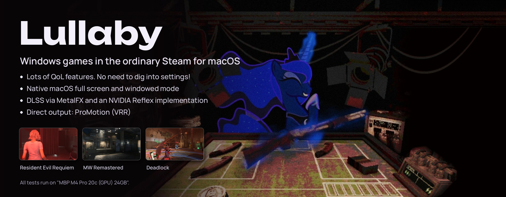

<h1 align="center"></h1>

<a href="README.md">Українська</a> · <b>English</b>

Play the Windows games of your Steam library right on a Mac, in the ordinary Steam for macOS, the way Steam Play (Proton) works on Linux. You get the full Steam gaming experience with a bias towards being native on the Mac. All of it thanks to the [Dormison](https://github.com/kageroumado/dormison) engine (Wine for macOS).

## Installation

1. You need an Apple silicon Mac, macOS 26 or newer, Rosetta and Steam in `/Applications`.
   Download `Lullaby-….zip` from the [latest release](https://github.com/Ruslan-Ukraina/Lullaby/releases/latest), unzip it and move Lullaby to `/Applications`.
2. Open Lullaby and press **Install**. It closes Steam carefully, patches it and downloads the engine.
3. Start Steam from `/Applications/Steam.app`. On a Windows game open "Properties → Compatibility", turn the compatibility tool on, and press Play.

The app is not notarized by Apple, so the first time open it through "System Settings → Privacy & Security → Open Anyway".

## What Lullaby does

| Component | Feature |
|---|---|
| **Windows and screen** | |
| `lby-pinkiepie-windowstate` | Game windows remember their last state and return to it. |
| `lby-trixie-fullscreen` | Native macOS full screen, the picture stretches without distortion or bars. |
| **Graphics** | |
| `lby-spitfire-apiscout` | Automatic renderer choice by the game's API: D3DMetal, DXMT, mtld3d, WineMetalGL or MoltenVK. |
| `lby-ponthree-pacer` | Direct output to the display, ProMotion (VRR). |
| `lby-rainbowdash-reflex` | NVIDIA Reflex for D3DMetal games, DLSS through MetalFX. |
| `lby-derpy-fixes` | DXMT tessellation, WineMetalGL and Retina fixes, DLSS frame generation, D3DMetal 4.0 beta 3 support and more. |
| **Input and sound** | |
| `lby-octavia-gcmouse` | Raw mouse without acceleration, the cursor does not conflict with the game or the Mac interface. |
| `lby-derpy-fixes` | Sound and the microphone switch to headphones and headsets automatically. |
| **Steam** | |
| `lby-luna-steamhook` | Lullaby in Steam for macOS: compatibility tool and game settings. |
| `lby-applejack-steambridge`, `lby-bigmack-steamexe` | Bridge to Steam: achievements, stats, friends. |
| `lby-spike-overlay` | Steam overlay in games. |
| `lby-shiningarmor-updategate` | Steam updates do not break games. |
| `lby-rarity-icons` | macOS-style game icons. |

## Credits and licences

| Частина | Звідки | Ліцензія |
|---|---|---|
| Lullaby (цей репозиторій) | на основі [NotProton](https://github.com/NotProtonNot/NotProton) від NotProtonNot і співавторів | GPL-3.0 |
| Рушій | [Dormison](https://github.com/kageroumado/dormison) (Wine + wine-staging + власні напрацювання) від kageroumado | LGPL-2.1-or-later |
| Каталог налаштувань, тексти, ідентифікація відеокарти | [Sevoflurane](https://github.com/kageroumado/sevoflurane) від kageroumado | MIT |
| Два виправлення рушія (облік пам'яті, розмір екрана Retina) | [Highball](https://github.com/gauthierpiarrette/highball-engine) від gauthierpiarrette | LGPL-2.1-or-later |
| Сира миша через GameController | [WineForge](https://github.com/Alien4042x/WineForge), у ньому Wine MR !11799 від Elvin Hayatov | LGPL-2.1-or-later |
| `lsteamclient` | [Proton](https://github.com/ValveSoftware/Proton) від Valve | Steamworks SDK License |
| `steam-shim` | `steam_helper` з Proton від Valve | BSD-3-Clause |
| DXMT, DXVK, MoltenVK | усередині релізу Dormison, без змін | LGPL-2.1-or-later, zlib, Apache-2.0 |
| Назви й структури для відповіді NVIDIA Reflex | [nvapi](https://github.com/NVIDIA/nvapi) від NVIDIA | MIT |
| Перехоплення функцій усередині Steam | [Dobby](https://github.com/jmpews/Dobby) від Jmpews | Apache-2.0 |
| Оновлення застосунку | [Sparkle](https://sparkle-project.org) | MIT |
| Direct3D 9 через Metal (завантажується в автора, коли знадобиться) | [mtld3d](https://github.com/athei/mtld3d) від athei | zlib |
| OpenGL через Metal (завантажується в автора, коли знадобиться) | [WineMetalGL](https://github.com/metalsharp/WineMetalGL) від MetalSharp | LGPL-3.0-or-later |
| D3DMetal (ваш) | Apple Game Porting Toolkit | ліцензія Apple, не поширюється |

Details, and which files belong to which part, are in [NOTICE](NOTICE).

## For developers

The map of the repository is `docs/STRUCTURE.md`, component names `docs/NAMING.md`, project rules `docs/PROJECT_RULES.md`. `make app` builds the app, `make app-tests` runs the Swift tests, `make patchcheck` checks the patches against the registry `patches/REGISTRY.md`.
