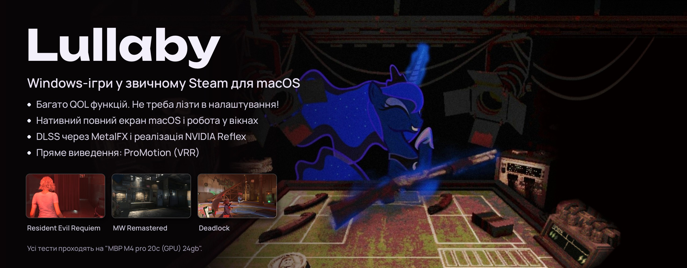

<h1 align="center"></h1>

<b>Українська</b> · <a href="README.en.md">English</a>

Грайте у Windows ігри зі своєї бібліотеки Steam просто на Mac - у звичному Steam для macOS, так само як Steam Play (Proton) на Linux. Ви отримуєте повноцінний досвід ігор у Steam з ухилом на нативність для Mac. Усе це завдяки рушію [Dormison](https://github.com/kageroumado/dormison) (Wine для macOS).

## Встановлення

1. Потрібен Mac на Apple silicon, macOS 26 або новіша, Rosetta і Steam у `/Applications`.
   Завантажте `Lullaby-….zip` з [останнього випуску](https://github.com/Ruslan-Ukraina/Lullaby/releases/latest), розпакуйте й перенесіть Lullaby у `/Applications`.
2. Відкрийте Lullaby й натисніть **Встановити**. Вона акуратно закриє Steam, пропатчить його й завантажить рушій.
3. Запускайте Steam з `/Applications/Steam.app`. У віндовс-гри відкрийте "Властивості → Сумісність", увімкніть інструмент сумісності - і тисніть "Грати".

Застосунок не завірений Apple (немає нотаризації), тому першого разу відкрийте його через "Системні параметри → Приватність і безпека → Усе одно відкрити".

## Що вміє Lullaby

| Компонент | Функція |
|---|---|
| **Вікна й екран** | |
| `lby-pinkiepie-windowstate` | Вікна гри запам'ятовують свій останній стан і повертаються до нього. |
| `lby-trixie-fullscreen` | Нативний повний екран macOS, картинка розтягується без спотворень і без смуг. |
| **Графіка** | |
| `lby-spitfire-apiscout` | Автовибір рендерера за API гри: D3DMetal, DXMT, mtld3d, WineMetalGL або MoltenVK. |
| `lby-ponthree-pacer` | Пряме виведення на дисплей, ProMotion (VRR). |
| `lby-rainbowdash-reflex` | NVIDIA Reflex для ігор на D3DMetal, DLSS через MetalFX. |
| `lby-derpy-fixes` | Виправлення тесселяції DXMT, WineMetalGL і Retina, генерація кадрів DLSS, підтримка D3DMetal 4.0 beta 3 та інше. |
| **Ввід і звук** | |
| `lby-octavia-gcmouse` | Сира миша без прискорення, курсор не конфліктує з грою та інтерфейсом Mac. |
| `lby-derpy-fixes` | Звук і мікрофон автоматично перемикаються за навушниками й гарнітурою. |
| **Steam** | |
| `lby-luna-steamhook` | Lullaby у Steam для macOS: інструмент сумісності й налаштування гри. |
| `lby-applejack-steambridge`, `lby-bigmack-steamexe` | Міст до Steam: досягнення, статистика, друзі. |
| `lby-spike-overlay` | Оверлей Steam у грі. |
| `lby-shiningarmor-updategate` | Оновлення Steam не ламає ігри. |
| `lby-rarity-icons` | Значки ігор у стилі macOS. |

## Подяки й ліцензії

| Частина | Звідки | Ліцензія |
|---|---|---|
| Lullaby (цей репозиторій) | на основі [NotProton](https://github.com/NotProtonNot/NotProton) від NotProtonNot і співавторів | GPL-3.0 |
| Рушій | [Dormison](https://github.com/kageroumado/dormison) (Wine + wine-staging + власні напрацювання) від kageroumado | LGPL-2.1-or-later |
| Каталог налаштувань, тексти, ідентифікація відеокарти | [Sevoflurane](https://github.com/kageroumado/sevoflurane) від kageroumado | MIT |
| Два виправлення рушія (облік пам'яті, розмір екрана Retina) | [Highball](https://github.com/gauthierpiarrette/highball-engine) від gauthierpiarrette | LGPL-2.1-or-later |
| Сира миша через GameController | [WineForge](https://github.com/Alien4042x/WineForge), у ньому Wine MR !11799 від Elvin Hayatov | LGPL-2.1-or-later |
| `lsteamclient` | [Proton](https://github.com/ValveSoftware/Proton) від Valve | Steamworks SDK License |
| `steam-shim` | `steam_helper` з Proton від Valve | BSD-3-Clause |
| DXMT, DXVK, MoltenVK | усередині релізу Dormison, без змін | LGPL-2.1-or-later, zlib, Apache-2.0 |
| Назви й структури для відповіді NVIDIA Reflex | [nvapi](https://github.com/NVIDIA/nvapi) від NVIDIA | MIT |
| Перехоплення функцій усередині Steam | [Dobby](https://github.com/jmpews/Dobby) від Jmpews | Apache-2.0 |
| Оновлення застосунку | [Sparkle](https://sparkle-project.org) | MIT |
| Direct3D 9 через Metal (завантажується в автора, коли знадобиться) | [mtld3d](https://github.com/athei/mtld3d) від athei | zlib |
| OpenGL через Metal (завантажується в автора, коли знадобиться) | [WineMetalGL](https://github.com/metalsharp/WineMetalGL) від MetalSharp | LGPL-3.0-or-later |
| D3DMetal (ваш) | Apple Game Porting Toolkit | ліцензія Apple, не поширюється |

Подробиці й те, які файли до якої частини належать, - у [NOTICE](NOTICE).

## Для розробників

Карта репозиторію - `docs/STRUCTURE.md`, назви компонентів - `docs/NAMING.md`, правила проєкту - `docs/PROJECT_RULES.md`. `make app` збирає застосунок, `make app-tests` запускає тести Swift, `make patchcheck` звіряє патчі з реєстром `patches/REGISTRY.md`.
